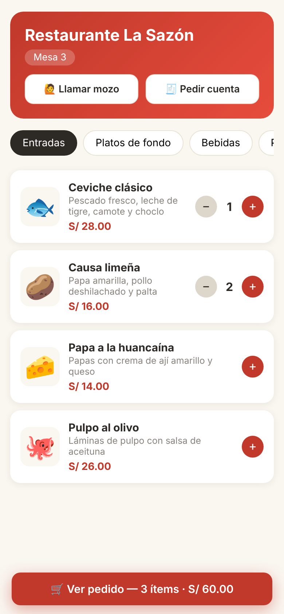
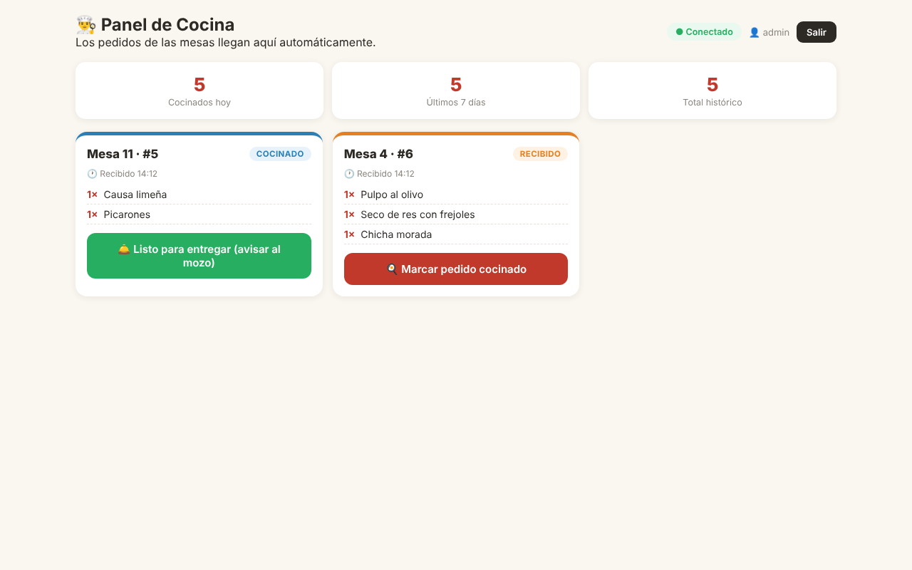
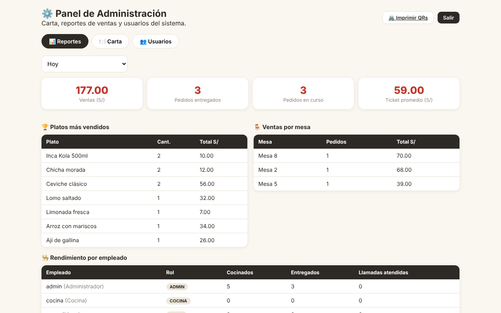

# 🍽️ QR Pedidos PRO

Sistema de pedidos por código QR para restaurantes. El cliente escanea el QR de su mesa y pide desde su celular. La cocina recibe el pedido al instante, y el mozo recibe una alerta cuando el plato está listo.

Funciona en la red WiFi del local, sin apps que instalar ni servicios de pago. Para usarlo desde fuera del local se puede activar un túnel de Cloudflare.

<p align="center">
  
  &nbsp;
  
</p>

## Qué hace

| Pantalla | Quién la usa | Funciones |
|---|---|---|
| **Cliente** `/mesa/:n` | Comensal, desde su celular | Ve la carta por categorías y arma su pedido con notas. Sigue en vivo las 4 fases del pedido y tiene botones para **llamar al mozo** y **pedir la cuenta** |
| **Cocina** `/cocina` | Tablet de cocina | Recibe los pedidos en tiempo real con alerta sonora. Marca *cocinado* y *listo* y ve sus estadísticas |
| **Mozo** `/mozo` | Celular del mozo | Recibe alertas de platos listos, llamadas de mesa y pedidos de cuenta, con sonido y vibración |
| **Administración** `/admin` | Dueño | Edita la carta sin tocar código y ve reportes de ventas (día, semana e histórico), rendimiento por empleado y gestión de cuentas |
| **QRs** `/qr` | Dueño | Genera e imprime el código QR de cada mesa |



## Arquitectura

Es Node.js puro, **sin dependencias de npm**: el servidor usa solo módulos nativos (`http`, `crypto`, `node:sqlite`). La única librería externa es [qrcode.js](https://github.com/davidshimjs/qrcodejs), que la página de QRs carga desde un CDN. Está organizado en cuatro capas con una sola responsabilidad cada una:

```
publico/        HTML + CSS + JS de cada pantalla
src/web/        servidor HTTP, enrutador, middlewares, eventos en vivo (SSE)
src/servicios/  reglas del negocio: fases del pedido, permisos, precios, reportes
src/repositorios/  único lugar con SQL
src/base-datos/ conexión SQLite, esquema con migraciones, copias de seguridad diarias
```

- **Tiempo real:** los pedidos, alertas y llamadas viajan por Server-Sent Events.
- **Máquina de estados:** `ordenado → cocinado → listo → entregado`. No se pueden saltar fases y cada transición la hace solo el rol que corresponde.
- **Persistencia:** SQLite en modo WAL, copias de seguridad automáticas (conserva 7 días) y registro de actividad con rotación.

Las reglas para modificar el código están en [`docs/LINEAMIENTOS.md`](docs/LINEAMIENTOS.md).

## Seguridad

- Contraseñas con hash **scrypt + sal única** y comparación en tiempo constante.
- **Sin contraseñas fijas:** la primera vez que arranca crea las cuentas `admin`, `cocina` y `mozo` con contraseñas aleatorias. Las muestra en la consola y las guarda en `datos/CLAVES-INICIALES.txt`, que queda fuera de git.
- Sesiones en cookies `HttpOnly` y `SameSite=Lax`, con control de acceso por rol en cada endpoint.
- Los precios y totales **se calculan en el servidor**; nunca se confía en lo que envía el celular.
- Validación de toda entrada, SQL parametrizado y límite de intentos de login y de pedidos por mesa.
- El canal público de eventos no expone notas ni montos de otras mesas.

## Cómo ejecutarlo

Requiere [Node.js 22 o superior](https://nodejs.org).

```bash
node iniciar.js            # o doble clic en INICIAR.bat en Windows
```

La consola muestra las direcciones para cada dispositivo de la red y las contraseñas iniciales. En Windows, `INSTALAR-ACCESOS.bat` crea accesos directos en el escritorio para cada pantalla.

| Variable | Uso |
|---|---|
| `PORT` | Puerto del servidor (por defecto 3000) |
| `QR_DATOS` | Carpeta de la base de datos y copias (por defecto `datos/`) |
| `QR_CLAVE_ADMIN`, `QR_CLAVE_COCINA`, `QR_CLAVE_MOZO` | Contraseñas iniciales fijas, opcionales (útiles para pruebas o despliegues) |

## Pruebas

```bash
npm test
```

Son **41 pruebas de extremo a extremo**. Levantan el servidor con una base de datos temporal y verifican sesiones, roles, la máquina de estados, cálculo de totales, reportes, llamadas al mozo y reglas de seguridad. Se ejecutan automáticamente en GitHub Actions con cada cambio.

---

**Autor:** Josue Banda Aguirre, estudiante de Ingeniería de Sistemas de Información (UPC, Lima). Es un proyecto personal.
